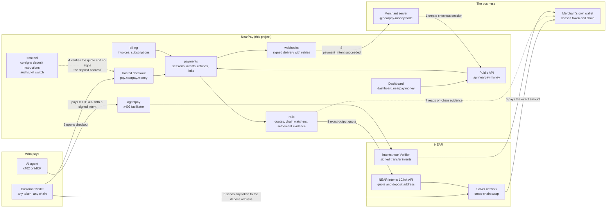
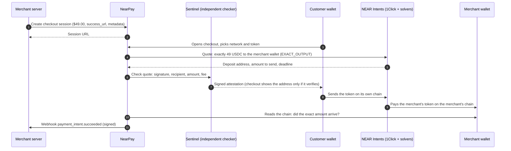

# NearPay

NearPay is a payment gateway for crypto, built on NEAR Intents. A business adds a checkout to its site with a few lines of code. Its customer pays with any token on any major chain. The business receives the token it chose, on the chain it chose, in its own wallet. NearPay never holds the money.

- **It is live on mainnet:** <https://nearpay.money> (closed beta, open sign-up).
- **A real product already uses it as its payment provider:** [Degen Market](https://degenmarket.lol), a paid leaderboard for crypto projects. Every listing there is paid through NearPay's hosted checkout. You can try NearPay as a paying customer in two minutes, without running anything: see [Path B](#path-b-pay-on-a-real-site-that-uses-nearpay).
- **This repository is the entry point.** It explains the product, links the 25 source repositories, and holds the scripts that verify the live deployment and run the whole system locally. It contains no product source code.

Built for the NEAR Hackathon, 1–14 November 2026. Tracks: `realworld` (Real-World Money) and `agents` (Agent Economy). Disclosures are in [Hackathon notes](#hackathon-notes).

## For judges: five ways to verify, shortest first

Every path is a list of "do X → see Y" steps. Paths A to C use the live deployment and need no installation beyond `curl` or a browser. Paths D and E run the code yourself.

| Path | What you do | Needs | Time |
|---|---|---|---|
| [A](#path-a-verify-the-live-deployment-from-a-terminal) | Run one script that checks the live site, API, docs and npm packages | `curl` | 30 s |
| [B](#path-b-pay-on-a-real-site-that-uses-nearpay) | Pay $1 on Degen Market, a real site that uses NearPay | Browser, a wallet with about $1.10 in any token | 2 min |
| [C](#path-c-become-a-merchant-on-the-live-deployment) | Sign up on nearpay.money, create a payment link, get paid in your own wallet (or simulate it in test mode with no funds) | Browser | 5 min |
| [D](#path-d-run-one-repositorys-tests-with-node-only) | Run any repository's unit tests | Node 22, no Docker | 5 min |
| [E](#path-e-run-the-whole-platform-locally) | Run the whole platform in test mode and walk through every feature | Docker, about 10 GB of memory | 30 min |

If you are an AI agent in a sandbox without a browser or Docker, do path A, then path D.

The live deployment runs on a single machine operated by the team. If a live check fails, paths D and E reproduce everything without it.

## What problem it solves

- **Merchants** who accept crypto today must pick chains, run a wallet per chain, watch each chain and reconcile by hand. They still lose customers who hold a different token.
- **Customers** must already hold the exact token on the exact chain, or bridge and swap first.
- **Developers** lack the payment tools they expect: an idempotent API, signed webhooks, a test mode, refunds, invoices and subscriptions.
- **AI agents** need to pay per request, in seconds, for cents. Card networks cannot do that.

NearPay gives the merchant one integration, modelled on the card-payment APIs developers already know, and uses NEAR Intents to turn "any token on any chain" into "exactly the amount and token the merchant asked for".

## How it works



One payment, step by step:



The money goes from the customer's wallet, through NEAR Intents, to the merchant's wallet. No NearPay account is on that path. NearPay's fee is taken by NEAR Intents as the payment settles (`appFees`), so NearPay never needs to hold a balance.

## How NEAR is used

| NEAR component | What NearPay uses it for | Where in the code |
|---|---|---|
| NEAR Intents **1Click API** | Turns any supported token on any chain into the exact amount of the merchant's token: `EXACT_OUTPUT` quotes, deposit addresses, status, refunds to the payer, NearPay's fee through `appFees` | `nearpay-rails` (`src/providers/oneclick`) |
| NEAR Intents **Verifier** (`intents.near`) | Settlement ledger for signed `transfer` intents: AI agents and customers with an Intents balance pay in about a second; merchants can receive into their Intents account | `nearpay-kit/packages/intents`, `nearpay-agentpay`, `nearpay-agentkit` |
| NEAR mainnet | Evidence of settlement, read by NearPay's own indexer; NearPay's relayer keys are function-call keys that can only pay gas | `nearpay-rails` (`src/verifiers`), `nearpay-sentinel` |
| x402 v2 | NearPay is an x402 facilitator with an `exact` scheme on `near:mainnet`, settled as an Intents transfer. Live: `GET https://api.nearpay.money/x402/supported` | `nearpay-agentpay`, `@nearpay-money/x402` |
| NEAR smart contract (Rust, `near-sdk`) | Auto-debit vault for subscriptions: the customer funds a mandate from their own account, can cancel any time and withdraw the rest. Built, tested and fuzzed. **Not deployed on mainnet**; test mode uses a simulated vault | `nearpay-contracts` |

## Path A: verify the live deployment from a terminal

```sh
git clone https://github.com/nearpay-money/nearpay && cd nearpay
scripts/verify-live.sh
```

→ See one `PASS` line per claim, then a JSON summary ending in `"ok":true`. The script only reads public URLs. It checks:

| Line | Claim it verifies |
|---|---|
| `site`, `docs`, `docs-ai`, `checkout`, `dashboard`, `js-loader` | The website, docs, hosted checkout, dashboard and browser loader are served |
| `api-health`, `api-errors` | The API answers, and errors follow the documented format with a link to the docs |
| `assets` | The API lists the tokens and chains a customer can pay with (the script prints the live counts) |
| `x402` | The x402 facilitator is live for `near:mainnet` |
| `sentinel-keys` | The independent checker publishes the keys it signs deposit instructions with |
| `npm-*` | The eight `@nearpay-money/*` packages are on npm |
| `integrator` | Degen Market is up and names NearPay as its payment provider |

Add `--sdk` (needs Node 20+ and npm) to also install `@nearpay-money/node` from npm and run it against the live API:

```sh
scripts/verify-live.sh --sdk
```

→ See `PASS sdk-webhooks` (a signed webhook verifies, a tampered one is rejected) and `PASS sdk-live` (the published SDK reaches the live API and gets the typed authentication error for a made-up key).

## Path B: pay on a real site that uses NearPay

[Degen Market](https://degenmarket.lol) is a public leaderboard where crypto projects pay for their rank. It is a separate product by the same founder, integrated through NearPay's public API like any other merchant would: a checkout session per purchase, fulfilled from the signed webhook. Its footer says "Payments by NearPay".

1. Open <https://degenmarket.lol> → see the leaderboard and, above it, the form "Claim #1 for $".
2. Leave the amount at $1, enter any project website or X handle, choose a category and press **Claim rank** → see NearPay's hosted checkout on `pay.nearpay.money`: the order and price on the dark side, the payment choices on the light side.
3. Choose the network and the token you hold (for example USDC on Base, SOL on Solana, or NEAR). Connect your wallet, or choose to send from another wallet → see the exact amount to send and the fee.
4. Approve the payment in your wallet → see "Confirming your payment", then "Paid", usually within seconds of your transaction's first block → you return to Degen Market, where the project's total has gone up by what you paid.

This is a real payment of about $1 plus the fee and network cost. The money goes to Degen Market's own wallet.

## Path C: become a merchant on the live deployment

Sign-up is open. There is no review step: you can receive a real payment a few minutes after signing up. The docs cover the same steps in more detail: <https://docs.nearpay.money/get-started>.

**Test mode first (no funds, no wallet, no business details):**

1. Open <https://dashboard.nearpay.money/signup>, enter an email address, open the link NearPay emails you and create a passkey on your device → see the dashboard.
2. Set the **Live / Test** switch (top right) to **Test** → see the strip "Test mode. No real funds move; payments use the sandbox."
3. **Payout wallets → Add payout wallet**: pick a token and a network, enter any address of that network and confirm with your passkey → see it listed as active. A test payout wallet needs no wallet signature.
4. **Payment links → Create payment link**: give it a name and a price of $5, then **Create link** → see the link, `https://pay.nearpay.money/l/…`.
5. Open the link and press **Continue to payment** → see the checkout with the banner "Test mode — no real funds". Pick a network and a token → see "Try a payment" with a **Simulate payment** button.
6. Press **Simulate payment** → see "Paid" a few seconds later. Back in the dashboard, **Payments** lists the payment as paid.

**Live mode (your own wallet receives real money):**

1. Switch to **Live**. In **Business details**, fill in and save your details. Nobody reviews them; they count as soon as they are saved.
2. **Payout wallets → Add payout wallet**: choose what you want to receive (for example USDC on Base) and your address, confirm with your passkey, then sign the ownership message with that wallet. Signing moves no funds → see the wallet active at once, and the dashboard says "Live payments are active".
3. **Payment links → Create payment link**: price $1 → open the link and pay from any other wallet, with any token on any chain → see "Paid" in the checkout, the payment in **Payments** with its on-chain transactions, and the money in your wallet.

**As a developer:** create a key in **Developers → API keys**, then:

```sh
npm install @nearpay-money/node
```

```ts
import { NearPay } from "@nearpay-money/node";
const nearpay = new NearPay(process.env.NEARPAY_SECRET_KEY!);
const session = await nearpay.checkout.sessions.create({
  amount: 4900, currency: "usd", success_url: "https://shop.example/thanks",
});
// redirect the customer to session.url; fulfil on the signed webhook payment_intent.succeeded
```

Or paste the prompt at <https://docs.nearpay.money/build-with-ai> into a coding agent and let it integrate NearPay into an existing project.

## Path D: run one repository's tests with Node only

Every repository installs its NearPay packages from a small local package registry. `nearpay-deploy` starts one without Docker:

```sh
git clone https://github.com/nearpay-money/nearpay-deploy
nearpay-deploy/scripts/registry.sh start
```

→ See a line starting `registry: up on http://127.0.0.1:4873`. It needs Node 22 only. Stop it with `nearpay-deploy/scripts/registry.sh stop`.

Then, for any repository in the [table below](#repositories), for example the Node SDK:

```sh
git clone https://github.com/nearpay-money/nearpay-node && cd nearpay-node
corepack enable && pnpm install --frozen-lockfile
pnpm test
```

→ See the unit tests pass. Each repository's README has a "Verify this repo" section with its exact commands and what they print. Unit tests need no Docker. `pnpm verify` also runs the integration tests, which start Postgres, NATS and Valkey in Docker.

## Path E: run the whole platform locally

Prerequisites: Docker 24+ with Compose 2.30+ and about 10 GB of memory, git, Python 3, Node 22 with pnpm (`corepack enable`), Google Chrome for the browser suites. [mkcert](https://github.com/FiloSottile/mkcert) is optional; it gives trusted local HTTPS, which passkeys need. Test mode needs no funds and no keys of yours: a sandbox service simulates NEAR Intents, the paying chains and the vault contract.

1. Clone every repository next to this one: `scripts/bootstrap.sh` → see 25 sibling folders (`nearpay-*`).
2. Start the stack: `scripts/up.sh local` → see "NearPay is up" with the local URLs. `curl -k https://api.nearpay.localhost/healthz` prints `ok`. The first run builds every service and takes a while. It creates test keys in `../nearpay-deploy/.secrets/` (never committed). Stop with `scripts/down.sh`.
3. Seed demo data: `../nearpay-deploy/scripts/seed.sh data` → see "demo merchant ready (test mode)".
4. Prepare the test bench. Every command below runs in `../nearpay-testbed`:

   ```sh
   cd ../nearpay-testbed
   pnpm run setup
   export NODE_EXTRA_CA_CERTS=../nearpay-deploy/.secrets/tls/ca.pem
   ```

Then walk through the features. "Verified by" names the end-to-end suite that checks the same thing: run one with `pnpm test:e2e <path>`, or a browser suite with `NP_E2E=1 pnpm test:pw <file>`.

| # | Do | See | Verified by |
|---|---|---|---|
| 5 | `pnpm demo:checkout` | A checkout URL; a scripted customer checks sentinel's signature and simulates the deposit; then `payment_intent.succeeded` arrives at the demo merchant with a valid signature | `e2e/api/checkout`, `e2e/checkout/hosted.pw.ts` |
| 6 | `pnpm demo:agent` | An AI agent calls a paid API: `402`, a signed NEAR Intents transfer, `200` with a `PAYMENT-RESPONSE` header, then `agent_payment.settled` | `e2e/agent/x402`, `e2e/stage3/agents` |
| 7 | In the dashboard (`https://dashboard.nearpay.localhost`; sign up, magic link in Mailpit at `https://mail.nearpay.localhost`, keep **Test** on): create a payment link, open it, pay, then refund the payment | The link's use count goes up; the payment appears; `refund.succeeded` and a receipt email in Mailpit | `e2e/stage2` |
| 8 | `pnpm test:e2e e2e/stage3/invoices e2e/stage3/subscriptions` | An invoice is finalised, emailed, paid from Base or Solana and its PDF stamped PAID; a subscription renews, goes past due when unpaid and recovers | the same suites |
| 9 | CLI: `pnpm -C ../nearpay-cli install && pnpm -C ../nearpay-cli build`, then `node ../nearpay-cli/dist/cli.js listen` in one terminal and `node ../nearpay-cli/dist/cli.js trigger payment_intent.succeeded` in another (set `NEARPAY_API_BASE=https://api.nearpay.localhost` and pass `--api-key` with the `sk_test_` key from `../nearpay-deploy/.secrets/demo.json`) | `listen` prints `--> payment_intent.succeeded [evt_…]` | `e2e/stage3/cli.pw.ts` |
| 10 | `pnpm test:e2e e2e/stage3/agents` | The MCP server (`@nearpay-money/mcp`) pays a checkout session and an invoice for an AI agent, and refuses payments over its budget or outside its allow-list | the same suite |
| 11 | `pnpm test:e2e e2e/stage4/mandates` | Auto-debit against the simulated vault: fund three periods, the keeper collects, the customer cancels and gets the rest back | the same suite, `e2e/stage4/vault-scenarios` |
| 12 | `pnpm test:e2e e2e/stage4/chains` | A Solana customer and a Bitcoin customer pay; each gets a sentinel-attested deposit address | the same suite |
| 13 | `pnpm test:e2e` and `NP_E2E=1 pnpm test:pw` | Every suite above | |

## What is built

"Live" below means the feature is switched on for real money at nearpay.money. Every row is also covered by automated end-to-end tests in test mode (Path E).

| Capability | State | Try it |
|---|---|---|
| Hosted checkout: the customer pays with any supported token on EVM chains, NEAR, Solana or Bitcoin; the merchant receives the token it chose | Live | Paths B and C |
| Payment links (no code) | Live | Path C |
| API, Node SDK, signed webhooks with retries, idempotency, test mode | Live | Paths A and C |
| Independent checker (sentinel) that co-signs every deposit address before the customer sees it, audits settled payments and can stop payments | Live | Path A `sentinel-keys`, Path E step 5 |
| Refunds, signed by the merchant | Live | Path E step 7 |
| Invoices, and subscriptions billed by invoice | Live | Path E step 8 |
| Agent payments: x402 facilitator, agent signer, MCP server with spending limits | Live | Path A `x402`, Path E steps 6 and 10 |
| CLI: login, listen, trigger | On npm | Path E step 9 |
| Embedded checkout (`@nearpay-money/js`, `@nearpay-money/react`) | On npm | `nearpay-js` README |
| Reconciliation and an operations console | Live, operators only | Path E step 7 |
| Subscriptions by automatic debit from a NEAR vault contract | Built and tested; **off in live mode** | Path E step 11 |

Known limits:

- The live deployment is a closed beta on one machine. It has monitoring, alerts and automatic restarts, but no redundancy.
- The auto-debit vault contract is not deployed on mainnet, so live subscriptions are billed by invoice. Deploying the contract is a human step that has not been taken.
- The fees shown on the site are indicative and may change.
- Live checkout is protected by a bot check (Cloudflare Turnstile), so a live payment cannot be driven by `curl` alone. Path A covers what can be checked without a browser; test mode (Paths C and E) has a scripted customer.
- A few tokens that NEAR Intents lists under its newest naming scheme (`1cs_v1:`) cannot be paid with yet. They are hidden from checkout.

## Repositories

`repos.json` is the machine-readable list. All are under <https://github.com/nearpay-money>. Design documents, decision records and per-service specifications are in `nearpay-brain`.

| Group | Repositories |
|---|---|
| Design | `nearpay-brain` |
| Contracts and shared code | `nearpay-spec` (every API, event and error, as schemas), `nearpay-kit` (shared libraries) |
| Services | `nearpay-identity`, `nearpay-payments`, `nearpay-billing`, `nearpay-rails`, `nearpay-agentpay`, `nearpay-compliance`, `nearpay-webhooks`, `nearpay-notify`, `nearpay-sandbox`, `nearpay-sentinel` |
| Web apps | `nearpay-checkout`, `nearpay-js`, `nearpay-dashboard`, `nearpay-console`, `nearpay-site` |
| SDKs and tools | `nearpay-node`, `nearpay-agentkit`, `nearpay-cli` |
| On-chain | `nearpay-contracts` |
| Platform | `nearpay-deploy`, `nearpay-infra`, `nearpay-testbed` |

Public npm packages: `@nearpay-money/spec`, `/node`, `/js`, `/react`, `/cli`, `/x402`, `/agent-signer`, `/mcp`.

## Hackathon notes

| Item | Value |
|---|---|
| Event | NEAR Hackathon, 2026-11-01 to 2026-11-14 23:59 UTC. Rules: <https://nearhackathon.com/HACKATHON.md> |
| Tracks | `realworld`: merchant payments, payment links, invoices, subscriptions, refunds. `agents`: x402 facilitator, agent-signed Intents transfers, MCP server with spending limits |
| New work | All of NearPay was written during the hackathon. The first commit in every repository is dated 2026-11-05. There is no earlier code and no fork |
| Other projects by the team | [Degen Market](https://degenmarket.lol) is a separate product by the same founder. It is NearPay's first live merchant and is disclosed here for that reason |
| AI assistance | Code and documentation in every repository were written with AI assistance (Claude) under human direction and review. Commits carry a `Co-Authored-By` line where an AI agent wrote them |
| Human-only actions | Providing credentials and accounts, signing mainnet transactions, spending funds, deploying, making repositories public, posting on X and submitting |
| Secrets | None are committed. Keys live in git-ignored `.secrets/` folders and environment variables. Test fixtures contain public test vectors only |
| Licence | Apache-2.0, in every repository |

Main libraries and services (each repository's README lists its own under "Built with"):

- **NEAR:** NEAR Intents 1Click API and its TypeScript SDK (`@defuse-protocol/one-click-sdk-typescript`), `@near-js/*`, `near-sdk` for Rust, HOT `near-connect` for wallets, x402.
- **Services:** TypeScript on Node 22, Fastify, Postgres with Kysely, NATS JetStream, Valkey, zod, OpenTelemetry, `jose`, `@noble/curves`.
- **Web:** React, Vite, Astro, `@simplewebauthn/browser`, `@web3icons/core`, viem, Wallet Standard.
- **Agents:** Model Context Protocol SDK.
- **Platform:** Docker Compose, Traefik, Verdaccio, Prometheus, Alertmanager, Grafana, Cloudflare Tunnel and Turnstile, Resend.
- **Testing:** Vitest, fast-check, Playwright, Testcontainers.

## Licence

Apache-2.0. See `LICENSE`.
